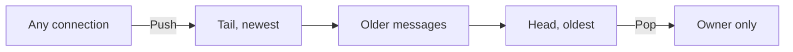
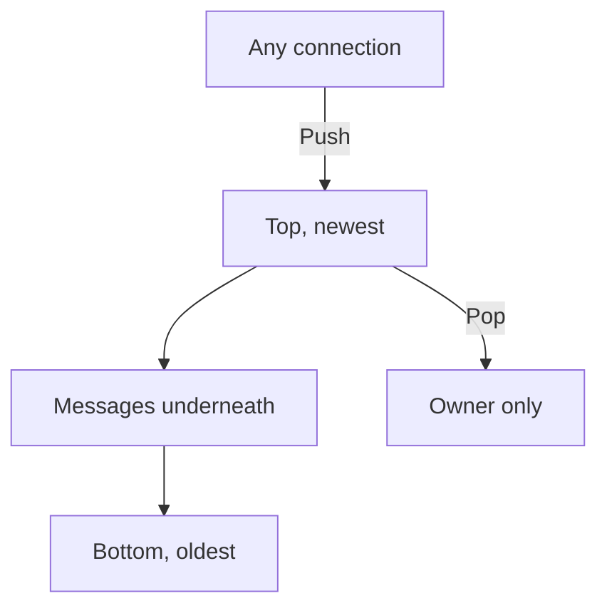
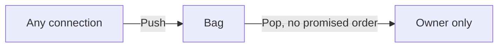

# Channels

A channel is a named buffer inside one broker process. The connection that creates it owns it. Any connection may push. Only the owner may pop or delete. Listeners on the same process share the channels, so a push on TCP can be popped by the owner on a Unix socket.

The wire values and field layout are in [protocol.md](protocol.md). Limits and `Channels.*` settings are in [configuration.md](configuration.md). Complete programs are in [examples.md](examples.md) and under `samples/`.

Every kind stores messages in one list. A push that is stored is appended at the tail. The tail is the newest message. The head is the oldest. The kind changes which end `Pop` removes from. It does not change who may push or pop.

| Kind | Wire value | Pop removes | Order callers may rely on |
| --- | ---: | --- | --- |
| `Queue` | 1 | The head | First in, first out |
| `Stack` | 2 | The tail | Last in, first out |
| `Bag` | 3 | Whichever stored message the server selects | None |

`CreateChannel` with type `0` uses `Channels.DefaultType`, which is `Queue` unless configured otherwise. The ack always returns the resolved kind, never `0`.

## Ownership and concurrency

- Many connections may push to the same channel. Pushes are applied one at a time.
- `Pop` and `DeleteChannel` from any other connection fail with `NotChannelOwner` (6). There are no competing consumers. A second worker cannot subscribe to the same channel.
- Each connection is read one frame at a time. A `Pop` occupies the owner connection until it returns. Another connection can push while that pop is waiting, and an accepted push wakes it. A push written on the owner connection itself is not read until the pop has finished, so the owner cannot satisfy its own outstanding pop.
- The server parks one waiting pop on a channel. An accepted push (the new body was stored) completes that wait. `Reject` and `DiscardNewest` do not store the new body, so they do not wake a parked pop.
- After the owner disconnects, the channel stays until `Channels.OrphanChannelTtl` (default 5 minutes) and is then deleted. Zero deletes it immediately. Pushes are still accepted while it is orphaned. Pops fail with `NotChannelOwner` because the owner connection is gone.

`MaxMessagesPerClient` counts messages a connection has pushed that are still queued, on every channel, not messages sitting in channels it owns. A pop releases that count for the original sender.

## Queue



A queue is first in, first out. `a` then `b` pops as `a` then `b`. A batch pop of 2 from `a`, `b`, `c` returns `a`, `b` and leaves `c` at the head.

The next pop looks at the head only. If that body is larger than the effective payload limit and the batch is still empty, the pop fails with `PayloadTooLarge` (8) and the head stays. If the head fits the payload limit but not the remaining frame, the batch stops and the head stays. The server does not skip the head to reach a later message.

Use a queue for work that must be handled in arrival order: orders, jobs, or a mailbox drained by the process that created it. Do not use it when the newest command should replace the oldest, when several processes must pop the same stream, or when one oversized head should be skipped so later messages can move.

```csharp
await client.CreateChannelAsync("orders", ChannelKind.Queue);
await client.PushAsync("orders", "a"u8.ToArray());
await client.PushAsync("orders", "b"u8.ToArray());
var messages = await client.PopAsync("orders", new PopOptions
{
    MaxMessages = 10,
    Timeout = TimeSpan.Zero
});
// "a", then "b"
```

## Stack



A stack is last in, first out. `a` then `b` pops as `b` then `a`. The top is the tail of the list. The bottom is the head.

Pop stops at the top the same way a queue stops at the head. An oversized top fails the pop with `PayloadTooLarge` when the batch is empty, and it is left in place. The server does not reach under it.

Use a stack for the newest item first: an undo log, a nested scope, or a command the latest writer should win. Do not use it for fair service. A producer that keeps pushing will bury older messages until a pop happens to reach them. `DiscardOldest` removes the bottom, which is the opposite end from pop, so a full stack drops the buried message and keeps the recent top.

```csharp
await client.CreateChannelAsync("undo", ChannelKind.Stack);
await client.PushAsync("undo", "a"u8.ToArray());
await client.PushAsync("undo", "b"u8.ToArray());
var messages = await client.PopAsync("undo", new PopOptions
{
    MaxMessages = 10,
    Timeout = TimeSpan.Zero
});
// "b", then "a"
```

## Bag



A bag has no order that callers may rely on. The protocol says receivers must not depend on pop order. The current server walks from the newest message toward the oldest and removes messages that fit the batch. That walk can change. Treat the result as a set.

Unlike a queue or a stack, a bag skips a message that does not fit this pop and tries another one. A message is skipped when its body exceeds the effective payload limit, or when adding it would make the ack frame larger than the connection's wire cap. If the batch is still empty and at least one message was skipped because the body itself was over the payload limit, the pop fails with `PayloadTooLarge` and nothing is removed. Messages that were only too large for the remaining frame stay queued, and the pop returns what it could take, or an empty list when it took nothing.

Use a bag for independent records where the owner only cares which bodies are present: cache invalidations, a set of blobs, or a pool of results. Do not use it for a sequence, a replay, or anything that breaks if `b` arrives before `a`. Do not use it when an oversized message must block the channel; a bag will step past that message when another one fits.

```csharp
await client.CreateChannelAsync("parts", ChannelKind.Bag);
await client.PushAsync("parts", "a"u8.ToArray());
await client.PushAsync("parts", "b"u8.ToArray());
var messages = await client.PopAsync("parts", new PopOptions
{
    MaxMessages = 10,
    Timeout = TimeSpan.Zero
});
// Both bodies are returned. Their order is not significant.
```

## Batches and timeouts

`PopOptions.MaxMessages` is the most messages to remove. The client sends at least 1. The server accepts 1 through 1024 (`ProtocolConstants.MaxPopBatch`) and rejects anything else with `InvalidMessage` (10).

A pop returns as soon as it can take one message, or as soon as it knows the next message cannot be returned. It does not wait for the batch to fill. One queued message and `MaxMessages` of 10 returns that one message.

The batch also stops when another message would make the ack larger than the connection wire cap (`MaxPayloadSize` plus the fixed frame envelope). The returned list can be shorter than `MaxMessages` for that reason. Queue and stack leave the message that did not fit. A bag skips it and continues, as described above.

`PopOptions.Timeout` of zero returns immediately. The list is empty when the channel has nothing to return. A positive timeout waits only in that empty case, until an accepted push stores a message or the time elapses. The wait does not collect further messages after the first one is available. On timeout the client gets an empty list, not an error. `null` uses `DomeMqClientOptions.PopTimeout` (30 seconds). The client waits a few seconds longer than the pop timeout for the ack so the server can answer after the wait.

Expired messages are removed before the pop chooses what to return. `Channels.DefaultMessageTtl` of null or zero means messages do not expire. Expiry drops them from the oldest end of the list. Those messages are not counted as dropped or cleared.

## Overflow

Four limits can stop a push:

| Limit | What it counts | Default |
| --- | --- | --- |
| Channel message cap | Messages stored in that channel | `Limits.MaxMessagesPerChannel` (100000), possibly lowered |
| Channel byte cap | Sum of application bodies in that channel | `Limits.MaxBytesPerChannel` (null, no per-channel cap) |
| Per-client cap | Messages that sender still has queued, on every channel | `Limits.MaxMessagesPerClient` (1000000) |
| Server memory cap | Sum of application bodies in every channel | `Limits.MaxQueuedBytes` (1 GiB) |

Byte caps count the application body only, not the frame around it. The channel's full policy runs when the new body does not fit. The policy is the same enum for every kind. What "oldest" means is the head of the list: the oldest insert. That is the queue head, the stack bottom, and the oldest insert in a bag.

| Policy | Wire | When the new body does not fit |
| --- | ---: | --- |
| `Reject` | 1 | Nothing is stored. The push fails with `ChannelFull` (9), `ClientQueueLimit` (17), or `ServerMemoryCap` (18). |
| `DiscardNewest` | 2 | The new body is dropped. The channel is unchanged. The ack status is `Discarded` (1) and `PushResult.Discarded` is true. This is not an error, including when the body could never fit. |
| `DiscardOldest` | 3 | Remove oldest inserts until the new body fits, then store it. The ack status is `Accepted`. Removed messages increment the dropped count. |
| `ClearAll` | 4 | If the new body fits in an empty channel, remove every message, then store it. The ack status is `Accepted`. Removed messages increment the cleared count, not the dropped count. |

`DropOldest` is an accepted alias for `DiscardOldest` in configuration.

Eviction only removes messages from the channel being pushed to. If the body is larger than that channel's byte cap, or the sender's remaining quota is held by messages on other channels, or the body is larger than the server memory cap, `DiscardOldest` and `ClearAll` refuse the push and leave the channel unchanged. `DiscardNewest` still answers `Discarded` in those cases. `Reject` answers with an error.

`DiscardOldest` on a queue drops the next message a pop would have returned. On a stack it drops the bottom, not the top a pop would return. On a bag it drops the oldest insert, which is not a defined pop position.

An accepted push that evicted older messages still has `PushResult.Discarded == false`. The depth in the ack is the number of messages stored after the push. A discarded push reports the unchanged depth.

### Which limit applies

On create, numeric caps combine as a minimum. A zero request means inherit.

```text
maxMessages = min(Limits.MaxMessagesPerChannel, Channels.Overrides[name].MaxMessages, request)
maxBytes    = min(Limits.MaxBytesPerChannel, Channels.Overrides[name].MaxBytes, request)
```

Unset levels are skipped. A requested message cap above `Limits.MaxMessagesPerChannel` is `InvalidQueueLimit` (16). The server does not clamp it. A requested byte cap above `Limits.MaxBytesPerChannel`, or above `Limits.MaxQueuedBytes`, is `InvalidByteLimit` (19).

The full policy prefers the create request when it is not `Inherit` (wire 0). Otherwise it uses the override's `FullBehavior` when that name has one, otherwise `Limits.FullBehavior` (`Reject`).

Payload size is separate from these caps. The effective body limit is the minimum of the server global limit, the listener limit, the channel limit, and the per-call limit. A create request above the global payload limit is `InvalidPayloadLimit` (15).

### QueuePressure

`Limits.WarningPercent` defaults to 80. The broker raises `QueuePressure` once when a fill level crosses that percentage upward. Further pushes while it stays at or above the line do not raise it again. The flag clears when the fill falls below the line, and the next upward crossing raises a new event. The handler runs on the push that crossed the line, before that push returns.

Fill for a channel is the greater of queued messages over the message cap and queued bytes over the byte cap. The event's `Scope` is the channel name. A server memory crossing uses scope `server`. A per-client crossing uses scope `client:` plus the sender's id in 32 hex digits. `Warning` is true. `DroppedMessages`, `ClearedMessages`, `QueuedMessages`, and `QueuedBytes` are included. The same crossing is logged at warning as `{scope} is {percent}% full.`

`GetStatistics` returns the process totals and one `ChannelStatistics` per channel: kind, policy, depth, bytes, caps, fill, dropped, cleared, whether the warning is currently active, and the owner's public session id.

```csharp
broker.QueuePressure += (_, notice) =>
{
    if (notice.Warning)
    {
        Console.WriteLine($"{notice.Scope} is {notice.FillPercent}% full.");
    }
};

var stats = broker.GetStatistics();
```

`samples/ChannelKinds` exercises order, batches, timeouts, and a second connection. `samples/OverflowPolicies` exercises the four policies, errors 16–19, pressure, and statistics.
