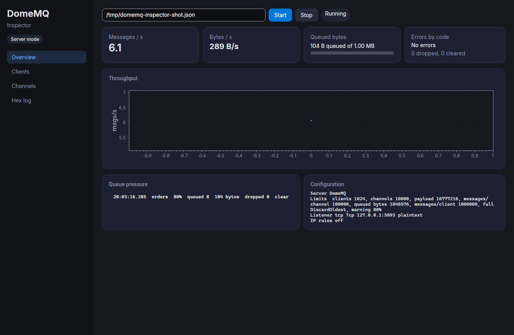
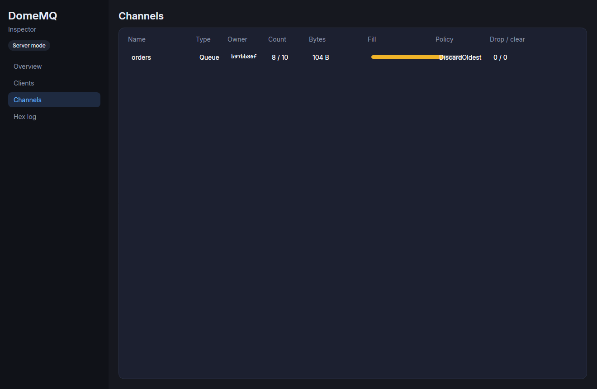
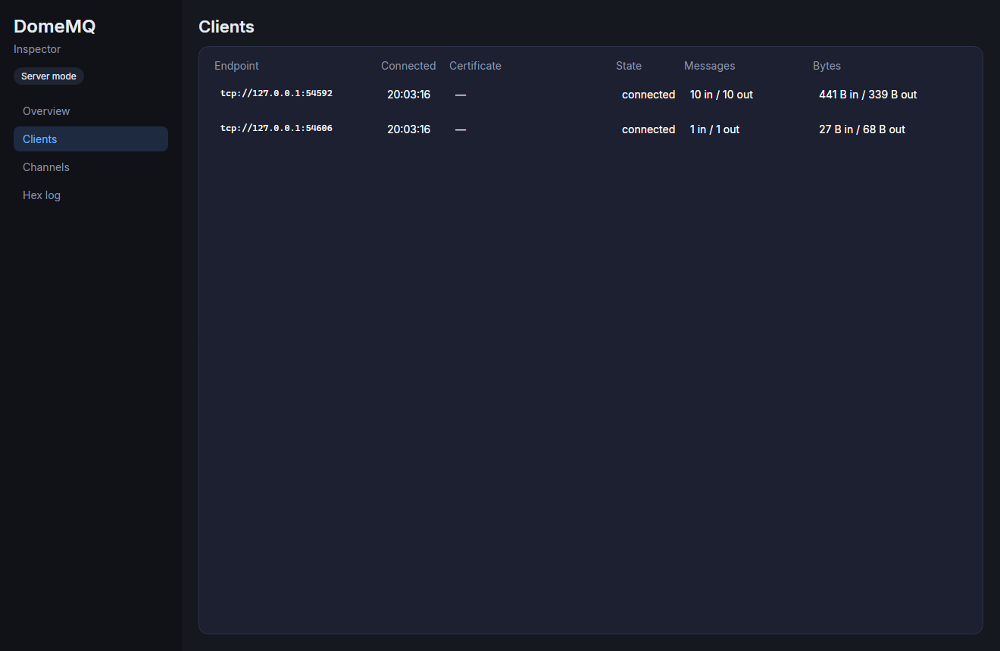
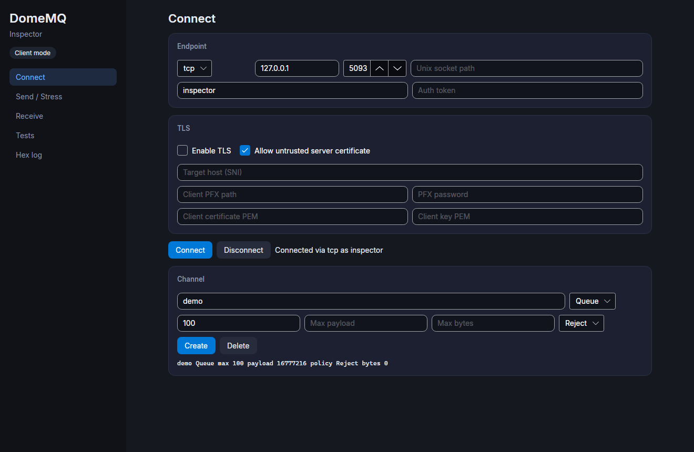
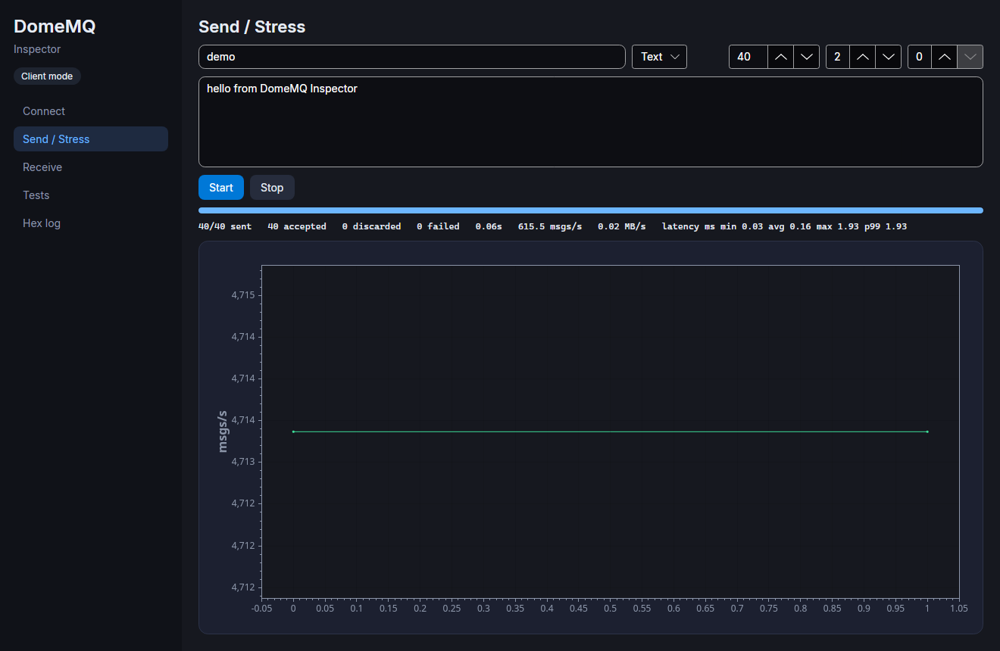
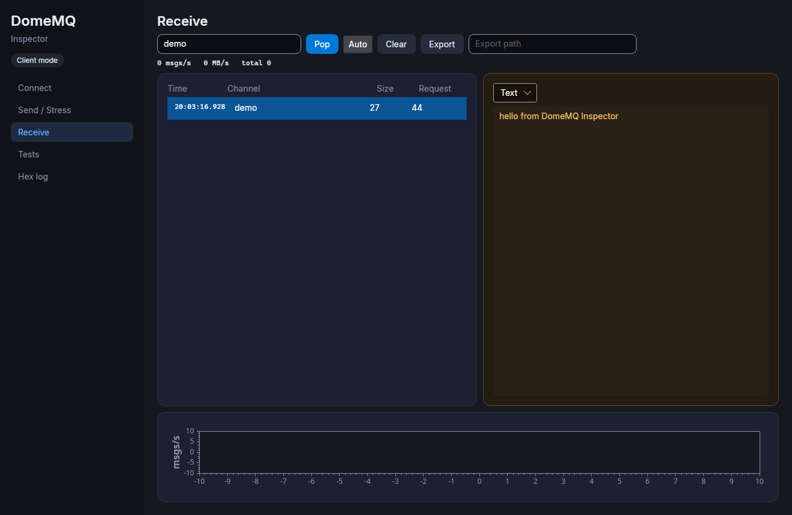
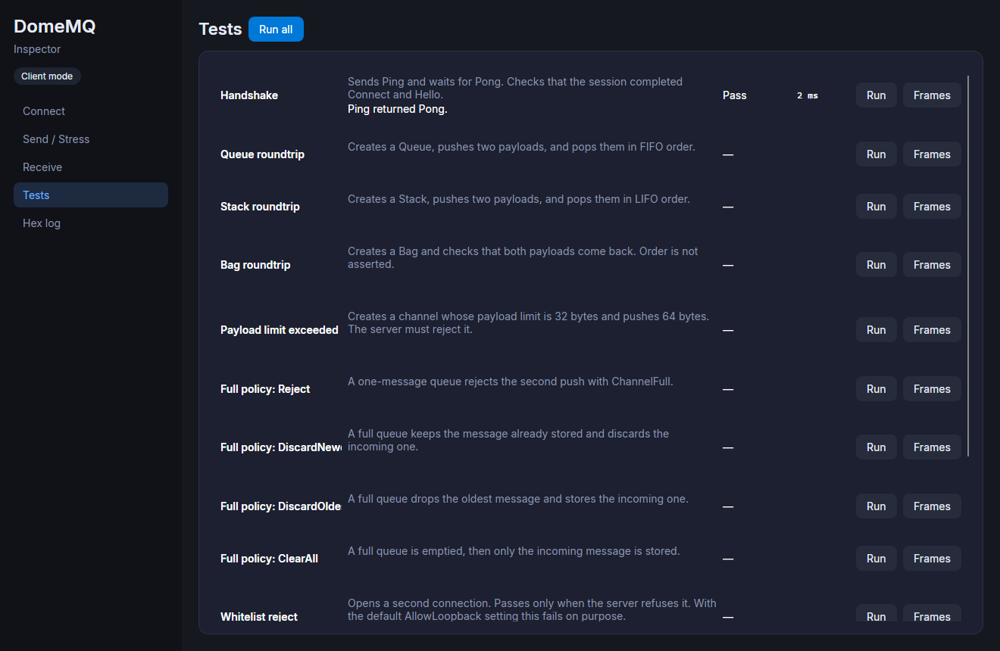
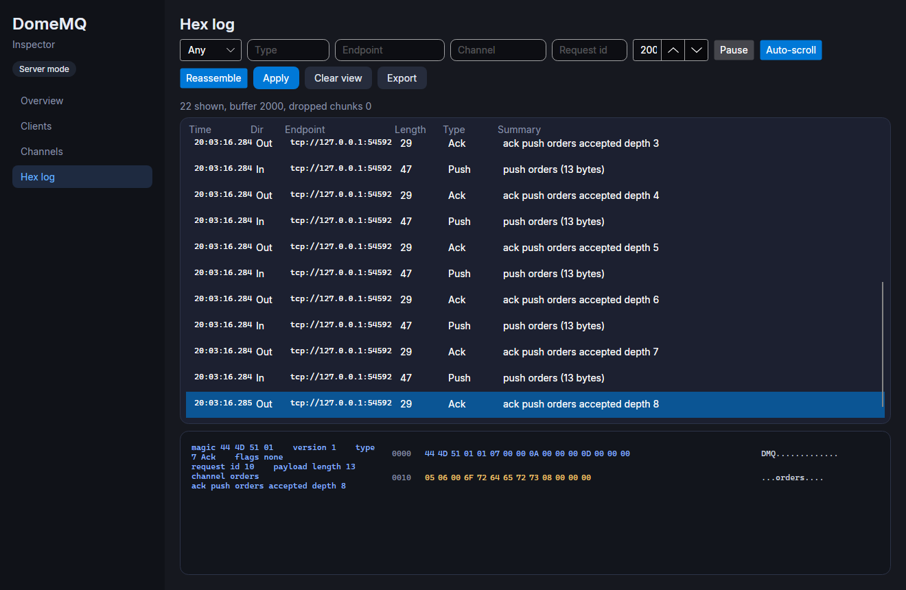
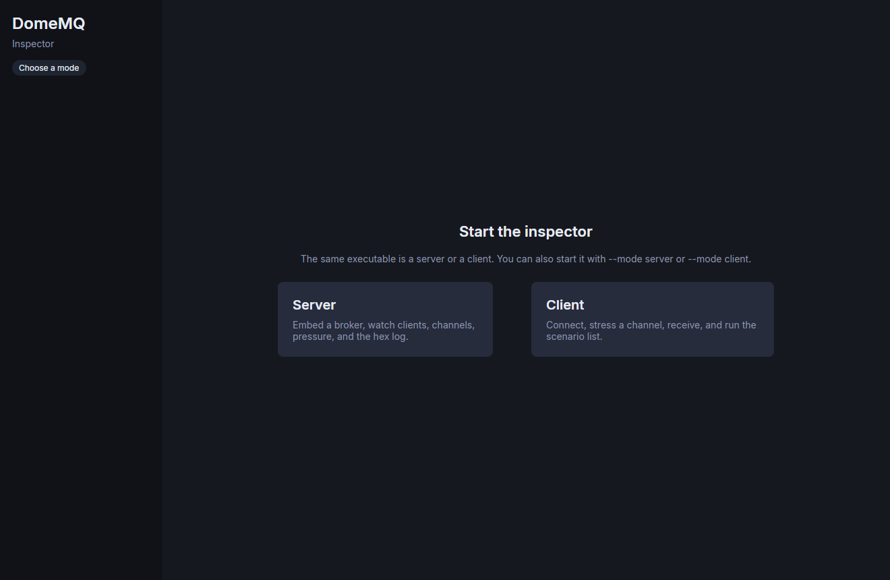

# DomeMQ Inspector

`tools/DomeMQ.Inspector` is a dark Fluent Avalonia app for looking at a live broker and for driving a client. Protocol, Client, Server, and the broker host stay free of UI packages. Avalonia, CommunityToolkit.Mvvm, and ScottPlot are referenced only by this project.

The same executable is the server and the client. Leave the mode off and the start screen asks, or pass it on the command line.

```bash
dotnet run --project tools/DomeMQ.Inspector
dotnet run --project tools/DomeMQ.Inspector -- --mode server
dotnet run --project tools/DomeMQ.Inspector -- --mode server --config path/to/appsettings.json
dotnet run --project tools/DomeMQ.Inspector -- --mode client
```

A published build is started the same way, without the extra `--`:

```bash
./DomeMQ.Inspector --mode server --config appsettings.json
./DomeMQ.Inspector --mode client
```

Release tags publish self-contained folders (not single-file) for `win-x64` and `linux-x64`. Native Skia ships beside the executable, so the zip is a directory.

## Server mode

Start embeds `DomeMqBroker`. An empty config path uses the defaults (TCP `0.0.0.0:5071`). A JSON file is the same document as the broker host: a `DomeMQ` section, or the options object at the root. Comments in the shipped `appsettings.json` are accepted.

Overview shows messages per second, bytes per second, queued bytes against `MaxQueuedBytes`, errors counted from `Error` frames, a throughput chart, the `QueuePressure` log, and a short config summary (listeners, TLS key id, limits, IP rules).

Clients lists each accepted connection: endpoint, connect time, client-certificate subject when the listener asked for one, the server key id chosen for that handshake, and messages and bytes in each direction. Channels lists name, type, owner id, count against the max, bytes, a fill bar that turns amber at 80%, the full policy, and the dropped and cleared counters. Kind, ownership, and overflow are described in [channels.md](channels.md).







## Client mode

Connect over TCP or a Unix socket. TLS can check the server certificate or allow an untrusted one, send an SNI name, pin the server SPKI hash or certificate file, and present a client PFX or PEM key. Create and delete are on the same screen: channel type, max messages, max payload, max bytes, and full policy.

Send / Stress takes a text or hex payload, a target channel, a repeat count, a parallel degree, and an interval. Start and Stop drive one session. The screen keeps a progress bar and reports sent, accepted, discarded, failed, elapsed time, msgs/s, MB/s, and latency min, average, max, and p99, plus a live chart.

Receive pops one message or loops. The list shows time, channel, size, and the pop request id. The selected body is shown as text, hex, or pretty JSON. The hex and JSON views use the payload color. Counters cover msgs/s, MB/s, and the total. Clear and Export write the list.

Tests runs a fixed set, one at a time or all. Each row says what it checks. A result is pass or fail, with the duration, and Frames jumps to the hex log range captured while it ran.

| Scenario | What it checks |
| --- | --- |
| Handshake | Ping returns Pong after Connect and Hello |
| Queue, Stack, Bag roundtrip | Push then pop, including order for Queue and Stack |
| Payload limit exceeded | A 64-byte push on a 32-byte channel is rejected |
| Full policy: Reject, DiscardNewest, DiscardOldest, ClearAll | The second push on a one-message queue |
| Whitelist reject | A second connection is refused. With `AllowLoopback` still on, this fails and the detail says so |
| TLS and mTLS | A second handshake using the Connect screen options. Fails with a setup note until those options are filled in |
| Throughput | 200 accepted pushes and the resulting rate |









## Hex log

Both modes share one log. `ITrafficObserver` is called from the socket and TLS-stream transports after every successful read and every successful partial write. The bytes are copied before the buffer is reused. An observer that throws is ignored so the connection stays up.

The log is the DomeMQ byte stream. With TLS, that is the decrypted stream, so frames can be decoded. The handshake records themselves are not part of this tap.

Chunks are reassembled into frames. The list shows time, direction (relative to this process), endpoint, length, type, and a one-line summary. Selecting a row opens the classic offset, hex, and ASCII view. Header bytes are blue and payload bytes are gold. The header is decoded beside it: magic `44 4D 51 01`, version, type, flags, request id, and payload length. Raw chunk mode turns reassembly off.

Filters cover direction, type, endpoint, channel, and request id. Pause freezes the grid, auto-scroll follows the tail, and the ring buffer defaults to 2000 frames. The UI drains at most 200 frames every 100 ms onto a virtualized list. Export writes the filtered frames as text.





## Hooks

`ITrafficObserver` and `TrafficChunk` live in `DomeMQ.Protocol`. Set `TransportSettings.TrafficObserver`, `DomeMqClientOptions.TrafficObserver`, or `DomeMqBroker.TrafficObserver` before connect or start.

`IBrokerConnectionObserver` on the server reports connect and disconnect. The snapshot carries the public session id, the endpoint, the connect time, and the client certificate subject. `ChannelStatistics.Owner` is that public id. `DomeMqMessage.RequestId` is the id of the pop that returned the body.
