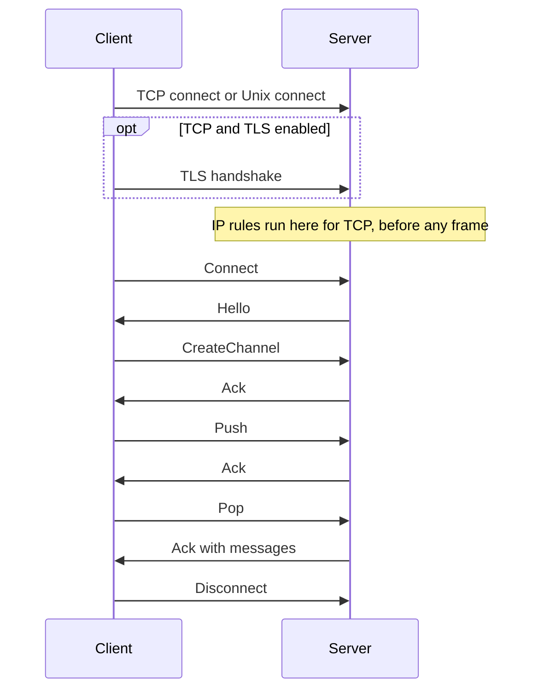
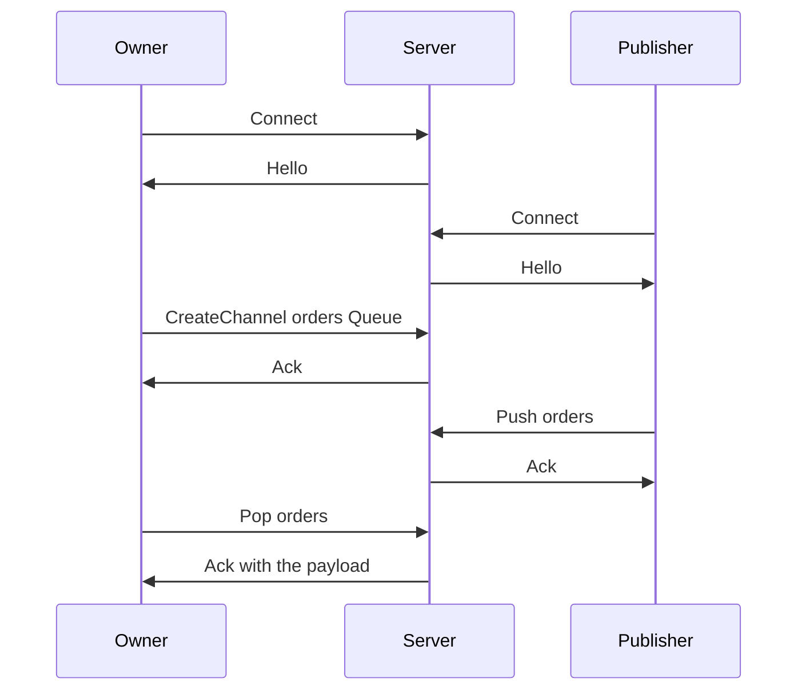
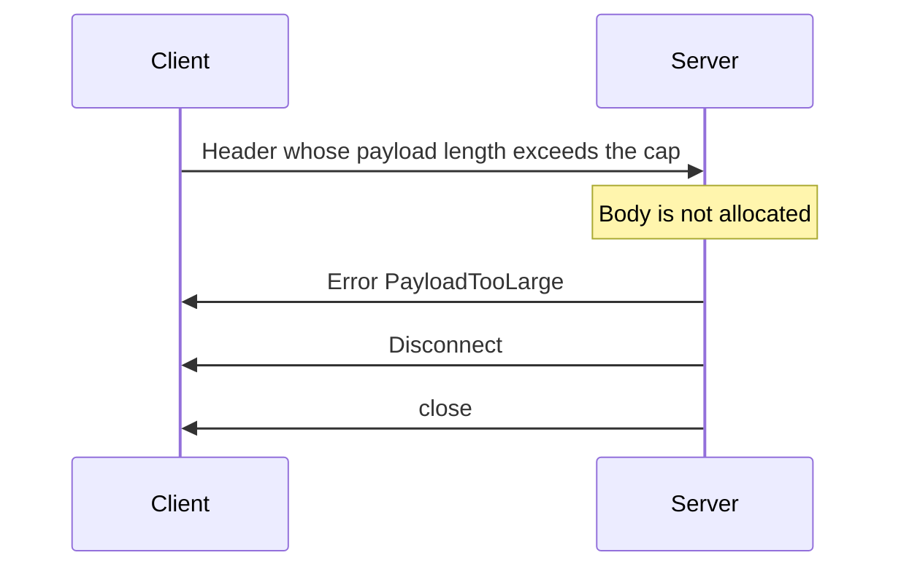

# DomeMQ protocol version 1

This document is the contract for a DomeMQ client in any language. DomeMQ does not use MessagePack, JSON, or any other third-party serializer on the wire. Control messages use the binary layout below. The application bytes moved by `Push` and `Pop` are opaque: the broker stores them and returns them unchanged.

The reference encoder and decoder are `DomeMQ.Protocol` (`FrameCodec`, `MessageCodec`). The unit tests parse the hex vectors in this file and require the reference encoder to produce them.

## Transport

A connection is a reliable byte stream.

| Transport | Status | Notes |
| --- | --- | --- |
| TCP | Implemented | Optional TLS. IP access rules apply. |
| Unix domain socket | Implemented | Stream sockets (`AF_UNIX`). No TLS. IP access rules do not apply. Works on Linux and Windows 10 version 1803 or later. |
| UDP | Reserved | Not implemented. A future transport should carry one frame per datagram. IP access rules will apply. |
| KCP | Reserved | Not implemented. A future reliable-UDP transport should present the same byte stream of frames. |
| Shared memory | Reserved | Not implemented. A future transport can use a named memory-mapped ring plus a cross-process signal. IP access rules will not apply. |

Frame boundaries are not marked by delimiters. Read the fixed header, then exactly `payloadLength` body bytes.

## Byte order and primitives

Every multi-byte integer in the header and in control bodies is **little-endian** and **fixed width**. There are no varints.

| Name | Width | Encoding |
| --- | --- | --- |
| `uint8` | 1 | Unsigned byte. |
| `uint16` | 2 | Unsigned, little-endian. |
| `uint32` | 4 | Unsigned, little-endian. |
| `uint64` / `int64` | 8 | Little-endian. `int64` is two's complement. |
| `bool` | 1 | `0` is false, `1` is true. Any other value is a protocol error. |
| `string` | 2 + N | `uint16` byte count `N`, then `N` UTF-8 bytes. No BOM. `N` is bytes, not characters. Invalid UTF-8 is a protocol error. |
| `bytes` | 4 + N | `uint32` byte count `N`, then `N` raw bytes. The broker does not interpret them. |

Limits on strings:

| Field | Maximum UTF-8 bytes |
| --- | --- |
| Channel name | 256 |
| Client name, server name | 256 |
| Auth token | 1024 |
| Content type | 256 |
| Error or disconnect text | 1024 |
| Session id | 64 |

A channel name must be non-empty and must not contain `U+0000`, `CR`, or `LF`. Comparison is case-sensitive and ordinal.

## Frame header

The header is always 16 bytes. `payloadLength` is the size of the body that follows. It does not include the header. The total frame size is `16 + payloadLength`.

| Offset | Size | Type | Field |
| ---: | ---: | --- | --- |
| 0 | 4 | bytes | Magic `44 4D 51 01` (`DMQ` plus `0x01`). The fourth byte identifies this header layout. |
| 4 | 1 | uint8 | Protocol version. Version 1 is `01`. |
| 5 | 1 | uint8 | Message type. |
| 6 | 2 | uint16 | Flags. |
| 8 | 4 | uint32 | Request id. |
| 12 | 4 | uint32 | Payload length. |
| 16 | N | bytes | Body. |

Example, a header for message type `Push` (`05`), flags `NoAck` (`01 00`), request id `0x01020304`, payload length 3:

```text
44 4d 51 01  01  05  01 00  04 03 02 01  03 00 00 00
magic        ver type flags   request id   length
```

### Flags

| Bit | Mask | Meaning |
| ---: | --- | --- |
| 0 | `0x0001` | `NoAck`. Honored on `Push`: the server does not send a success `Ack`. Errors are still sent. Other requests are acknowledged anyway. |
| 1–7 | | Must-understand. A set bit the receiver does not know is `ProtocolError`. |
| 8–15 | | Optional hints. Receivers must ignore unknown bits in this range. |

### Request id

The client chooses a non-zero `uint32` for each request and the server echoes it on `Hello`, `Ack`, `Error`, and `Pong`. Request id `0` means "no correlation" and is used for server-initiated `Ping`/`Disconnect` only when the sender does not expect a matched reply. Clients that need to match responses must not use `0`.

## Message types

| Value | Name | Direction | Body |
| ---: | --- | --- | --- |
| 1 | `Connect` | Client → server | Client hello. |
| 2 | `Hello` | Server → client | Reply to `Connect`. |
| 3 | `CreateChannel` | Client → server | Create a receive channel. |
| 4 | `DeleteChannel` | Client → server | Delete a channel the sender owns. |
| 5 | `Push` | Client → server | Append an opaque payload to a channel. |
| 6 | `Pop` | Client → server | Read from a channel the sender owns. |
| 7 | `Ack` | Server → client | Success. The first body byte is the request's message type. |
| 8 | `Error` | Server → client | Failure. The request id matches the request. |
| 9 | `Ping` | Either direction | Liveness probe. |
| 10 | `Pong` | Either direction | Reply to `Ping`, same request id. |
| 11 | `Disconnect` | Either direction | Graceful close. No reply is required. |

Unknown message types are `InvalidMessage` when the header itself is well formed.

## Forward compatibility

Control bodies have a fixed field order. A later revision may only **append** fields.

- A version-1 decoder reads the fields listed for that message and **ignores leftover bytes** inside the declared payload length.
- A future decoder treats a missing tail (the body ends before an appended field) as the documented default for that field. Every field listed in this document is required in version 1. A truncated required field is `InvalidMessage`.
- The application payload is not a control field. It is a length-prefixed `bytes` value. New control fields are appended after it, and old decoders ignore them because they stop after the byte array.

Do not insert fields in the middle. Do not change the width of an existing field. An incompatible header layout requires a new magic byte.

## Versioning

- Magic `44 4D 51 01` means "this 16-byte header".
- Header version and `Connect.protocolVersion` must both be `1` and must match. A mismatch is `ProtocolError`.
- A server that understands the header but not the version replies with `Error` / `UnsupportedVersion` and closes.
- A bad magic byte closes the connection. The peer cannot resynchronize.

## Channels

A channel is a named buffer owned by the connection that created it. Pop order, batches, timeouts, and overflow for each kind are described in [channels.md](channels.md).

| Kind | Value | Push | Pop |
| --- | ---: | --- | --- |
| Server default | 0 | — | CreateChannel only. The server substitutes its configured default (`Queue` unless changed). |
| `Queue` | 1 | Add at the tail. | Remove from the head (FIFO). |
| `Stack` | 2 | Add at the top. | Remove from the top (LIFO). |
| `Bag` | 3 | Add. | Remove an arbitrary message. Order is not part of the contract. |

Anyone connected may `Push`. Only the owner may `Pop` or `DeleteChannel`. When the owner disconnects, the channel stays until `OrphanChannelTtl` (default 5 minutes) and is then deleted. `OrphanChannelTtl` of zero deletes it immediately. Pushes are still accepted while it is orphaned. Pops fail with `NotChannelOwner` because the owner is gone.

`maxMessages` (`maxQueueLength` in older wording) of `0` means inherit. The effective cap is the minimum of the server global maximum (default 100000), a configured per-name override, and the non-zero request. A request above the global maximum is `InvalidQueueLimit`. The server does not clamp it.

`maxBytes` of `0` means inherit. The effective byte cap is the minimum of the set levels (global per-channel cap, configured override, request). A request above the global per-channel cap or the server memory cap is `InvalidByteLimit`.

When a push would pass one of those caps, the per-client outstanding-message cap, or the server-wide queued-byte cap, the channel's full policy decides:

| Policy | Value | Effect |
| --- | ---: | --- |
| `Reject` | 1 | The message is not stored. The sender gets `ChannelFull`, `ClientQueueLimit`, or `ServerMemoryCap`. |
| `DiscardNewest` | 2 | The incoming message is dropped. The channel is unchanged. The ack status is `Discarded` (1). |
| `DiscardOldest` | 3 | Evict the oldest entry until the new message fits, then store it. Queue evicts the head. Stack evicts the bottom. Bag evicts the oldest insert. Ack status is `Accepted`. |
| `ClearAll` | 4 | If the new message fits after the channel is emptied, remove every queued message and store the new one. Ack status is `Accepted`. |

Eviction only removes messages from the target channel. A message that cannot fit even after that (it is larger than the byte cap, or the sender's quota is held by other channels) is rejected and the channel is left unchanged. `ClearAll` does not clear when the new message still would not fit.

## Application payloads

`Push` and `Pop` carry an application body as raw `bytes`. DomeMQ does not parse it. A client may put UTF-8, JSON, MessagePack, Protobuf, or anything else in those bytes. That choice is entirely outside the protocol.

`contentType` is an optional opaque label stored next to the bytes and returned on pop. The empty string means "no label". The broker does not branch on it. There is no content-type flag that selects a serializer.

### Payload limits

`MaxPayloadSize` is the maximum **application body** size in bytes, not the size of the whole frame.

The effective limit is the minimum of the levels that are set:

```text
effective = min(server global, listener override, channel override, message override)
```

Unset levels are skipped. The server global limit is always set (default **16777216**, 16 MiB). A listener, channel, or message limit of null (client API) or `0` (on the wire) means "inherit".

| Level | Where it is set | Above the ceiling |
| --- | --- | --- |
| Server global | `Limits.MaxPayloadSize` | Startup fails if it is outside 1 .. 256 MiB. |
| Listener | `Listeners[].MaxPayloadSize` | Must be between 1 and the global limit. Applied to pushes and pops on that connection. |
| Channel | `CreateChannel.maxPayloadSize` | `0` inherits the global limit. A non-zero value **greater than the global limit is rejected** with `InvalidPayloadLimit`. The server does not clamp. The stored cap is not reduced by the creating connection's listener limit, because other listeners may push. |
| Message | `Push.maxPayloadSize` or `Pop.maxPayloadSize` | `0` inherits. A non-zero value only tightens the cap. It cannot raise it. |

`Hello.maxPayloadSize` is the connection ceiling: `min(global, listener)` for the listener that accepted the socket. The client should refuse to send an application body larger than `min(Hello.maxPayloadSize, client default, known channel cap, per-call limit)`.

The largest frame body the server will allocate is `MaxPayloadSize + 65536` (`FrameEnvelopeReserve`, 64 KiB of names and prefixes around one application body). Inbound frames other than `Push` are also capped at 256 KiB so a huge `Connect` cannot force a large allocation. A frame whose declared length exceeds the cap is rejected **before the body is allocated**: the server logs it, sends `Error` / `PayloadTooLarge` with request id `0`, sends `Disconnect`, and closes. The stream is not resynchronized.

`Pop` may return several messages. The encoded `Ack` must fit in the connection wire cap. The server stops adding messages before the frame would exceed that cap.

If the next `Queue` or `Stack` message is larger than the pop's effective limit, the server leaves it in place and returns `PayloadTooLarge`. A `Bag` may skip oversized messages and return others that fit. If a bag contains only oversized messages, the result is `PayloadTooLarge` and they stay in the bag.

An empty pop (timeout with nothing available) is a success `Ack` with a message count of `0`, not an error.

## Control bodies

Fields are listed in order. Decoders ignore bytes after the last field they know.

### Connect (1)

| Order | Name | Type | Notes |
| ---: | --- | --- | --- |
| 0 | `clientName` | string | Display name. May be empty. |
| 1 | `protocolVersion` | uint8 | Must equal the header version. |
| 2 | `authToken` | string | Empty when the client has no token. |

The first frame on a connection must be `Connect`. Any other type is `NotConnected` and the server closes.

### Hello (2)

| Order | Name | Type | Notes |
| ---: | --- | --- | --- |
| 0 | `serverName` | string | |
| 1 | `protocolVersion` | uint8 | Negotiated version. |
| 2 | `sessionId` | string | 32 lowercase hex characters in the reference server. |
| 3 | `maxPayloadSize` | uint32 | Connection ceiling, never 0. |
| 4 | `maxQueueLength` | uint32 | Server default queue length. |
| 5 | `defaultChannelType` | uint8 | `ChannelKind` used when create sends type 0. |

### CreateChannel (3)

| Order | Name | Type | Notes |
| ---: | --- | --- | --- |
| 0 | `name` | string | |
| 1 | `channelType` | uint8 | 0, 1, 2, or 3. |
| 2 | `maxMessages` | uint32 | 0 = inherit. This is the per-channel message cap. A non-zero value above the server global maximum is rejected. |
| 3 | `maxPayloadSize` | uint32 | 0 = inherit the global limit. |
| 4 | `fullPolicy` | uint8 | Optional. Omitted or 0 inherits the server policy. 1 Reject, 2 DiscardNewest, 3 DiscardOldest, 4 ClearAll. |
| 5 | `maxBytes` | uint32 | Optional. 0 inherits. A non-zero value above the server per-channel or memory cap is rejected. |

Fields 4 and 5 are appended. A decoder that stops after field 3 still accepts a longer body. A new decoder treats a missing tail as policy 0 and maxBytes 0.

Creating a name that already exists is `ChannelExists`, including when the same owner asks twice.

### CreateChannel Ack

`Ack` whose first byte is `3`.

| Order | Name | Type | Notes |
| ---: | --- | --- | --- |
| 0 | `ackedType` | uint8 | `3` |
| 1 | `name` | string | |
| 2 | `channelType` | uint8 | Resolved kind, never 0. |
| 3 | `maxMessages` | uint32 | Effective message cap. Never 0. |
| 4 | `maxPayloadSize` | uint32 | Channel cap, or the global limit when the request inherited it. Never 0. |
| 5 | `fullPolicy` | uint8 | Optional. Resolved policy, never 0 when the server sends it. |
| 6 | `maxBytes` | uint32 | Optional. Effective byte cap, or 0 when the channel has none. |

### DeleteChannel (4)

| Order | Name | Type |
| ---: | --- | --- |
| 0 | `name` | string |

### DeleteChannel Ack

| Order | Name | Type | Notes |
| ---: | --- | --- | --- |
| 0 | `ackedType` | uint8 | `4` |
| 1 | `name` | string | |

### Push (5)

| Order | Name | Type | Notes |
| ---: | --- | --- | --- |
| 0 | `channelName` | string | |
| 1 | `maxPayloadSize` | uint32 | 0 = inherit. Tightens the effective limit for this message only. |
| 2 | `contentType` | string | Opaque label. Empty is allowed. |
| 3 | `body` | bytes | Opaque application payload. Empty is allowed. |

### Push Ack

| Order | Name | Type | Notes |
| ---: | --- | --- | --- |
| 0 | `ackedType` | uint8 | `5` |
| 1 | `channelName` | string | |
| 2 | `depth` | uint32 | Messages in the channel after the push. |
| 3 | `status` | uint8 | Optional. 0 Accepted (or omitted). 1 Discarded: `DiscardNewest` dropped the incoming message and left the channel unchanged. |

### Pop (6)

| Order | Name | Type | Notes |
| ---: | --- | --- | --- |
| 0 | `channelName` | string | |
| 1 | `maxMessages` | uint32 | 1 .. 1024. |
| 2 | `timeoutMs` | uint32 | 0 returns immediately. Otherwise wait until at least one message arrives or the timeout elapses. |
| 3 | `maxPayloadSize` | uint32 | 0 = inherit. Applied per returned message. |

### Pop Ack

| Order | Name | Type | Notes |
| ---: | --- | --- | --- |
| 0 | `ackedType` | uint8 | `6` |
| 1 | `channelName` | string | |
| 2 | `count` | uint32 | Number of messages that follow. May be 0. |
| 3 | `messages` | repeated `count` times | Each message is `contentType` (`string`) then `body` (`bytes`). |

### Error (8)

| Order | Name | Type | Notes |
| ---: | --- | --- | --- |
| 0 | `code` | uint16 | See the error table. |
| 1 | `message` | string | Human-readable, English, not stable for parsing. |
| 2 | `relatedType` | uint8 | Message type of the failed request, or 0. |

### Ping (9) and Pong (10)

`Ping`: `int64 unixTimeMs`. The value may be 0.

`Pong`: `int64 echoedUnixTimeMs`, then `int64 serverUnixTimeMs`.

Either side may send `Ping`. The reference client answers `Ping` with `Pong` and uses the same request id. The reference server does the same.

### Disconnect (11)

| Order | Name | Type |
| ---: | --- | --- |
| 0 | `reasonCode` | uint16 |
| 1 | `reason` | string |

| Code | Name |
| ---: | --- |
| 0 | Normal |
| 1 | ProtocolError |
| 2 | Shutdown |
| 3 | IdleTimeout |
| 4 | HandshakeTimeout |
| 5 | Unauthorized |
| 6 | TooManyClients |
| 7 | PayloadTooLarge |

## Error codes

| Code | Name | When |
| ---: | --- | --- |
| 0 | `Unspecified` | Unused by the reference server. |
| 1 | `ProtocolError` | Bad flags, version mismatch, second `Connect`. |
| 2 | `UnsupportedVersion` | Header version is not 1. |
| 3 | `Unauthorized` | Shared-key token does not match. The server then closes. |
| 4 | `ChannelNotFound` | No channel with that name. |
| 5 | `ChannelExists` | Name already taken. |
| 6 | `NotChannelOwner` | Pop or delete by a connection that did not create the channel. |
| 7 | `InvalidChannelType` | Type byte is not 0, 1, 2, or 3. |
| 8 | `PayloadTooLarge` | Application body, or a frame the server refuses to allocate, exceeds the effective limit. |
| 9 | `ChannelFull` | Push while full and the server policy is `Reject`. |
| 10 | `InvalidMessage` | Truncated body, bad UTF-8, bad bool, unknown type, `maxMessages` out of range. |
| 11 | `NotConnected` | Any message before a successful `Connect`. |
| 12 | `InternalError` | Reserved. |
| 13 | `TooManyChannels` | Server or per-client channel limit. |
| 14 | `TooManyClients` | Reserved for a protocol-level refusal. The reference server closes extra connections before handshake instead. |
| 15 | `InvalidPayloadLimit` | `CreateChannel.maxPayloadSize` is greater than the server global limit. |
| 16 | `InvalidQueueLimit` | `CreateChannel.maxMessages` is greater than the server maximum. |
| 17 | `ClientQueueLimit` | The sender already has too many unconsumed queued messages. |
| 18 | `ServerMemoryCap` | Queued application bytes would exceed the server memory cap. |
| 19 | `InvalidByteLimit` | `CreateChannel.maxBytes` is greater than the server per-channel or memory cap. |

## Connection flow



Two processes:



Oversized frame:



IP rejection does not use this protocol. The server accepts the TCP socket, logs the address, and closes it before reading a frame. Unix sockets skip that check.

A quiet connection receives `Ping` from the server at `HeartbeatInterval` (default 30 seconds). Any received frame resets the idle timer. If nothing arrives for `IdleTimeout` (default 5 minutes), the server sends `Disconnect` / `IdleTimeout` and closes.

## Reading a frame

```text
header = read_exact(16)
if header[0:4] != 44 4D 51 01: fail
version = header[4]
type = header[5]
flags = uint16_le(header[6:8])
request_id = uint32_le(header[8:12])
length = uint32_le(header[12:16])
if length > cap(type): fail without reading the body
body = read_exact(length)
decode the known fields from the front of body
ignore body[decoded_end:]
```

## Test vectors

Each vector is one complete frame: the 16-byte header followed by the body. Bytes are lowercase hexadecimal. The reference encoder produces these exact bytes. `connect-trailing` is the `connect` vector plus two extra body bytes (`ff 00`) and a length field increased by 2. A decoder must accept it as the same `Connect`.

Logical contents:

| Vector | Contents |
| --- | --- |
| `connect` | Request id 1. Name `demo`, version 1, empty token. |
| `hello` | Request id 1. Server `DomeMQ`, version 1, session `0123456789abcdef0123456789abcdef`, max payload 16777216, max queue 100000, default type Queue (1). |
| `create-channel` | Request id 2. Name `orders`, type Queue, message cap 0 (inherit), payload limit 0 (inherit). The policy and byte-cap tail is omitted. |
| `create-channel-limits` | Request id 2. Same channel, plus policy DiscardOldest (3) and maxBytes 4096. |
| `push-ack-discarded` | Request id 4. Push ack for `orders`, depth 2, status Discarded (1). |
| `create-channel-ack` | Request id 2. Effective queue length 100000, effective payload limit 16777216. |
| `delete-channel` | Request id 3. Name `orders`. |
| `push-raw` | Request id 4. Channel `orders`, inherited limit, empty content type, body `hello` (`68 65 6c 6c 6f`). |
| `push-labeled` | Request id 5. Message limit 64, content type `application/json`, body the raw UTF-8 bytes of `{"n":1}`. The broker does not parse those bytes. |
| `pop` | Request id 6. Up to 8 messages, timeout 1000 ms, inherited payload limit. |
| `pop-ack` | Request id 6. One message, content type `application/json`, body `{"n":1}`. |
| `error-payload-too-large` | Request id 4. Code 8, text `Payload too large.`, related type Push (5). |
| `ping` | Request id 7. Unix time 1000. |
| `pong` | Request id 7. Echo 1000, server time 1001. |
| `disconnect` | Request id 0. Reason 0, text `bye`. |
| `connect-trailing` | `connect` plus two ignored body bytes. |

### connect

```hex
44 4d 51 01 01 01 00 00 01 00 00 00 09 00 00 00 04 00 64 65 6d 6f 01 00 00
```

### hello

```hex
44 4d 51 01 01 02 00 00 01 00 00 00 34 00 00 00 06 00 44 6f 6d 65 4d 51 01 20 00 30 31 32 33 34 35 36 37 38 39 61 62 63 64 65 66 30 31 32 33 34 35 36 37 38 39 61 62 63 64 65 66 00 00 00 01 a0 86 01 00 01
```

### create-channel

```hex
44 4d 51 01 01 03 00 00 02 00 00 00 11 00 00 00 06 00 6f 72 64 65 72 73 01 00 00 00 00 00 00 00 00
```

### create-channel-limits

```hex
44 4d 51 01 01 03 00 00 02 00 00 00 16 00 00 00 06 00 6f 72 64 65 72 73 01 00 00 00 00 00 00 00 00 03 00 10 00 00
```

### create-channel-ack

```hex
44 4d 51 01 01 07 00 00 02 00 00 00 12 00 00 00 03 06 00 6f 72 64 65 72 73 01 a0 86 01 00 00 00 00 01
```

### push-ack-discarded

```hex
44 4d 51 01 01 07 00 00 04 00 00 00 0e 00 00 00 05 06 00 6f 72 64 65 72 73 02 00 00 00 01
```

### delete-channel

```hex
44 4d 51 01 01 04 00 00 03 00 00 00 08 00 00 00 06 00 6f 72 64 65 72 73
```

### push-raw

```hex
44 4d 51 01 01 05 00 00 04 00 00 00 17 00 00 00 06 00 6f 72 64 65 72 73 00 00 00 00 00 00 05 00 00 00 68 65 6c 6c 6f
```

### push-labeled

```hex
44 4d 51 01 01 05 00 00 05 00 00 00 29 00 00 00 06 00 6f 72 64 65 72 73 40 00 00 00 10 00 61 70 70 6c 69 63 61 74 69 6f 6e 2f 6a 73 6f 6e 07 00 00 00 7b 22 6e 22 3a 31 7d
```

### pop

```hex
44 4d 51 01 01 06 00 00 06 00 00 00 14 00 00 00 06 00 6f 72 64 65 72 73 08 00 00 00 e8 03 00 00 00 00 00 00
```

### pop-ack

```hex
44 4d 51 01 01 07 00 00 06 00 00 00 2a 00 00 00 06 06 00 6f 72 64 65 72 73 01 00 00 00 10 00 61 70 70 6c 69 63 61 74 69 6f 6e 2f 6a 73 6f 6e 07 00 00 00 7b 22 6e 22 3a 31 7d
```

### error-payload-too-large

```hex
44 4d 51 01 01 08 00 00 04 00 00 00 17 00 00 00 08 00 12 00 50 61 79 6c 6f 61 64 20 74 6f 6f 20 6c 61 72 67 65 2e 05
```

### ping

```hex
44 4d 51 01 01 09 00 00 07 00 00 00 08 00 00 00 e8 03 00 00 00 00 00 00
```

### pong

```hex
44 4d 51 01 01 0a 00 00 07 00 00 00 10 00 00 00 e8 03 00 00 00 00 00 00 e9 03 00 00 00 00 00 00
```

### disconnect

```hex
44 4d 51 01 01 0b 00 00 00 00 00 00 07 00 00 00 00 00 03 00 62 79 65
```

### connect-trailing

```hex
44 4d 51 01 01 01 00 00 01 00 00 00 0b 00 00 00 04 00 64 65 6d 6f 01 00 00 ff 00
```
